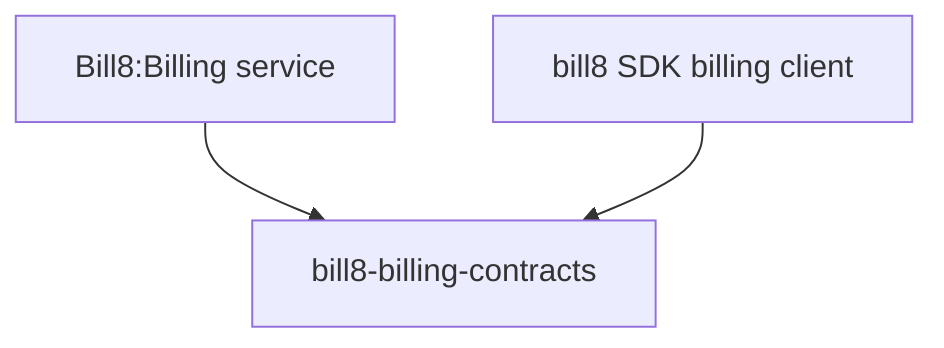

# bill8-billing-contracts

Wire types for the Bill8:Billing HTTP API.

## 1. Summary

`bill8-billing-contracts` defines the serde DTOs exchanged with
Bill8:Billing (`Product`, `Price`, `Subscription`, `SubscriptionItem`,
`Invoice`, `InvoiceItem`, `UsageRecord`, `Coupon`, `Credit`). It is the
single source of truth for the billing wire format.

## 2. Motivation

Billing spans products, subscriptions, invoices, and usage across the
merchant and portal apps; a shared contracts crate keeps shapes in lock
step and pins money as JSON strings.

## 3. Architecture & High-Level Design

## 4. Key Traits and Data Structures

- `Price` - a recurring or one-off price point with `interval`
  (`day/week/month/year`) and `unit_amount` (JSON string).
- `Subscription` - a plan instance with `status`
  (`incomplete/active/past_due/canceled`).
- `Invoice` - a generated bill with `status` (`draft/open/paid/void`).
- `UsageRecord` - a metered consumption event.

## 5. Rationale, Trade-offs, and Alternatives

- Inert data types; string-typed money.

## 6. Internal Implementation & Invariants

- Money fields are JSON strings; statuses use canonical spellings.

## 7. Unresolved Questions / Future Designs

- None.

---

**Design attribution:** bill8:billing and its underlying concepts were designed by Hamid Jahanzad <Hamid@Jahanzad.com>.
