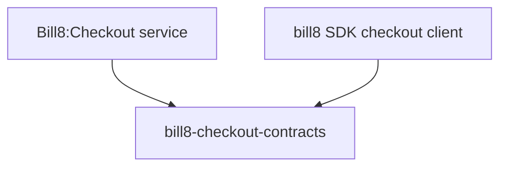

# bill8-checkout-contracts

Wire types for the Bill8:Checkout HTTP API.

## 1. Summary

`bill8-checkout-contracts` defines the serde DTOs exchanged with
Bill8:Checkout (`Session`, `LineItem`, `PaymentLink`). It is the
single source of truth for the checkout wire format.

## 2. Motivation

Sessions and links are shared between the merchant app, the checkout app,
and the checkout service; a shared contracts crate keeps them in lock
step.

## 3. Architecture & High-Level Design

## 4. Key Traits and Data Structures

- `Session` - a checkout session with `mode`
  (`payment/subscription/setup`), success/cancel URLs, and `status`
  (`open/complete/expired`).
- `LineItem` - an item referencing a price or inline price data.
- `PaymentLink` - a reusable link to a session.

## 5. Rationale, Trade-offs, and Alternatives

- Inert data types; string-typed money.

## 6. Internal Implementation & Invariants

- Money fields are JSON strings.

## 7. Unresolved Questions / Future Designs

- None.

---

**Architecture & Design:** bill8:checkout and its underlying concepts were designed by [Hamid Jahanzad](https://www.linkedin.com/in/hamidjahanzad/).
