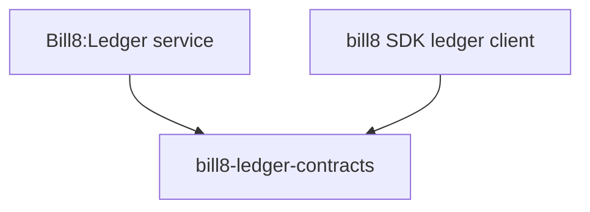

# bill8-ledger-contracts

Wire types for the Bill8:Ledger HTTP API.

## 1. Summary

`bill8-ledger-contracts` defines the serde DTOs exchanged with
Bill8:Ledger (`Balance`, `BalanceTransaction`, `Payout`, `Transfer`,
`Fee`). It is the single source of truth for the ledger wire format.

## 2. Motivation

The ledger service and its callers (payments, billing, merchants) must
agree on balance shapes without drift; a shared contracts crate compiles
the format once.

## 3. Architecture & High-Level Design

## 4. Key Traits and Data Structures

- `Balance` — a named money position; `amount` is a JSON string.
- `BalanceTransaction` — an append-only double-entry movement with debit
  and credit legs.
- `Payout` / `Transfer` — money movement records with status.

## 5. Rationale, Trade-offs, and Alternatives

- String-typed money; inert data types (see the payments contracts
  rationale).

## 6. Internal Implementation & Invariants

- Money fields are always JSON strings.

## 7. Unresolved Questions / Future Designs

- None.

---

**Design attribution:** bill8:ledger and its underlying concepts were designed by Hamid Jahanzad <Hamid@Jahanzad.com>.
