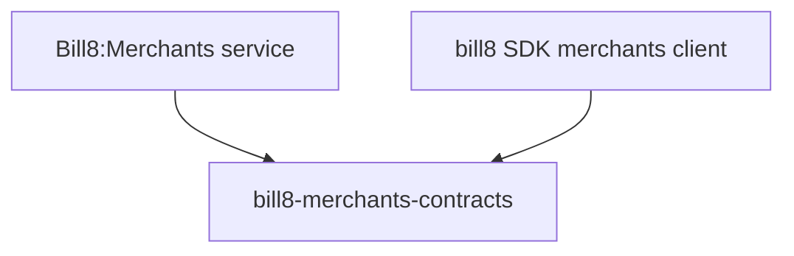

# bill8-merchants-contracts

Wire types for the Bill8:Merchants HTTP API.

## 1. Summary

`bill8-merchants-contracts` defines the serde DTOs exchanged with
Bill8:Merchants (`Account`, `Person`, `ExternalAccount`,
`AccountLink`, `LoginLink`). It is the single source of truth for the
merchants wire format.

## 2. Motivation

Connected-account onboarding spans the merchant app, the portal, and the
admin surface; a shared contracts crate keeps their wire shapes in lock
step.

## 3. Architecture & High-Level Design

## 4. Key Traits and Data Structures

- `Account` - a connected account with `verification_status`
  (`unverified/pending/verified/rejected`).
- `Person` - an individual associated with an account.
- `ExternalAccount` - a payout destination (secret-by-reference fields).

## 5. Rationale, Trade-offs, and Alternatives

- Inert data types; string-typed money (see the payments contracts
  rationale).

## 6. Internal Implementation & Invariants

- Verification status uses the canonical enum spellings.

## 7. Unresolved Questions / Future Designs

- None.

---

**Architecture & Design:** bill8:merchants and its underlying concepts were designed by [Hamid Jahanzad](https://www.linkedin.com/in/hamidjahanzad/).
