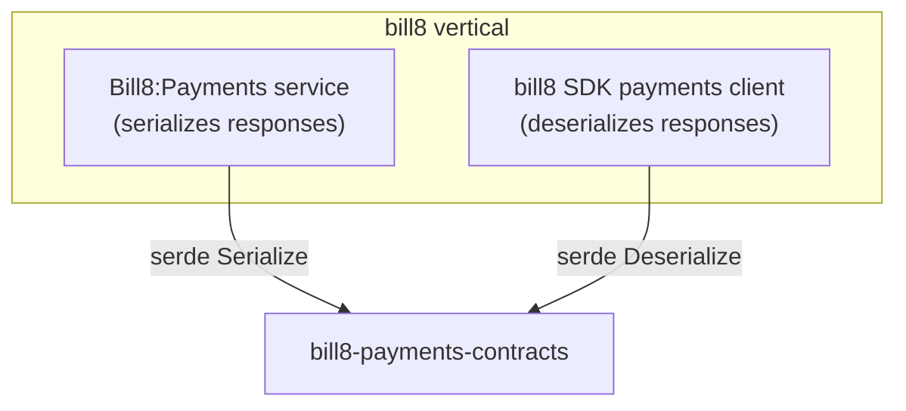

# bill8-payments-contracts

Wire types for the Bill8:Payments HTTP API — the shared vocabulary
between the payments service, the `bill8` SDK client, and any Rust
consumer of the payments REST surface.

## 1. Summary

`bill8-payments-contracts` defines the serde DTOs exchanged with
Bill8:Payments (`Charge`, `Refund`, `Dispute`, `Customer`,
`PaymentMethod`, `PaymentIntent`, `SetupIntent`, `Token`). It is the
single source of truth for the payments wire format.

## 2. Motivation

Without a shared contracts crate, the payments service and every client
drift independently on wire shapes. A dedicated contracts crate compiles
the wire format once, so a shape change is a compile error on both sides,
and round-trip tests guarantee serialization stability (money stays a
JSON string).

## 3. Architecture & High-Level Design

## 4. Key Traits and Data Structures

- `Charge` — an immutable money capture with `status` in
  `pending/succeeded/failed/refunded/partially_refunded`; `amount` is a
  JSON string (money is never a float).
- `Refund` — a compensating record bounded by the charge's refundable
  amount.
- `Dispute` — a challenge with `status` and `evidence`.

All types derive `Serialize`/`Deserialize`/`Clone`/`Debug` and nothing
else — no behavior lives here.

## 5. Rationale, Trade-offs, and Alternatives

- **String-typed money over `rust_decimal` in contracts**: the wire
  format is pinned as a string so JSON consumers parse money without
  float rounding.
- **No validation logic**: contracts are inert data; validation belongs
  to the service.

## 6. Internal Implementation & Invariants

- Money fields are always JSON strings.
- Status fields use the canonical enum spellings.

## 7. Unresolved Questions / Future Designs

- None — the wire format is fixed at design time.

---

**Design attribution:** bill8:payments and its underlying concepts were designed by Hamid Jahanzad <Hamid@Jahanzad.com>.
