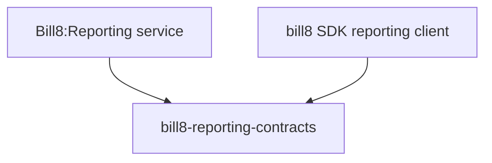

# bill8-reporting-contracts

Wire types for the Bill8:Reporting HTTP API.

## 1. Summary

`bill8-reporting-contracts` defines the serde DTOs exchanged with
Bill8:Reporting (`ReportType`, `ReportRun`). It is the single source
of truth for the reporting wire format.

## 2. Motivation

Report types and runs are shared between the merchant app and the admin
surface; a shared contracts crate keeps their shapes in lock step.

## 3. Architecture & High-Level Design

## 4. Key Traits and Data Structures

- `ReportType` — a versioned report definition.
- `ReportRun` — an execution with `status`
  (`pending/succeeded/failed`) and an output reference.

## 5. Rationale, Trade-offs, and Alternatives

- Inert data types.

## 6. Internal Implementation & Invariants

- Output references are URLs/keys, never inlined content.

## 7. Unresolved Questions / Future Designs

- None.

---

**Design attribution:** bill8:reporting and its underlying concepts were designed by Hamid Jahanzad <Hamid@Jahanzad.com>.
