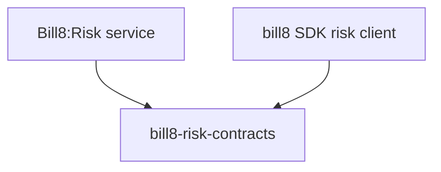

# bill8-risk-contracts

Wire types for the Bill8:Risk HTTP API.

## 1. Summary

`bill8-risk-contracts` defines the serde DTOs exchanged with
Bill8:Risk (`Rule`, `Screening`, `Review`). It is the single source
of truth for the risk wire format.

## 2. Motivation

Screening requests originate in payments (M2M) and rules/reviews are
managed in the admin surface; a shared contracts crate keeps their shapes
in lock step.

## 3. Architecture & High-Level Design

## 4. Key Traits and Data Structures

- `Rule` - a declarative predicate with an `action`
  (`allow/review/block`).
- `Screening` - an evaluation result.
- `Review` - a manual adjudication case with `status`
  (`open/approved/declined`).

## 5. Rationale, Trade-offs, and Alternatives

- Inert data types.

## 6. Internal Implementation & Invariants

- Actions/statuses use canonical enum spellings.

## 7. Unresolved Questions / Future Designs

- None.

---

**Architecture & Design:** bill8:risk and its underlying concepts were designed by [Hamid Jahanzad](https://www.linkedin.com/in/hamidjahanzad/).
