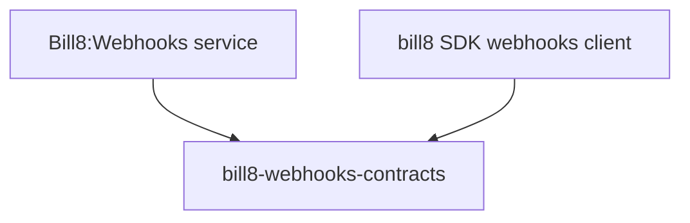

# bill8-webhooks-contracts

Wire types for the Bill8:Webhooks HTTP API and event envelopes.

## 1. Summary

`bill8-webhooks-contracts` defines the serde DTOs exchanged with
Bill8:Webhooks (`WebhookEndpoint`, `Event`, `Delivery`) and the
signed event envelope shape.

## 2. Motivation

Endpoints, events, and deliveries are shared between the merchant app,
the admin surface, and external consumers of signed payloads; a shared
contracts crate pins their shapes and the envelope signature.

## 3. Architecture & High-Level Design

## 4. Key Traits and Data Structures

- `WebhookEndpoint` - a merchant URL with enabled event types and a
  signing secret reference.
- `Event` - a materialized event with `id`, `type`, `data`, `created`.
- `Delivery` - a delivery attempt with `status` and retry count.

## 5. Rationale, Trade-offs, and Alternatives

- Inert data types; secret-bearing fields are references.

## 6. Internal Implementation & Invariants

- Signing secrets are never serialized in plaintext responses.

## 7. Unresolved Questions / Future Designs

- None.

---

**Architecture & Design:** bill8:webhooks and its underlying concepts were designed by [Hamid Jahanzad](https://www.linkedin.com/in/hamidjahanzad/).
