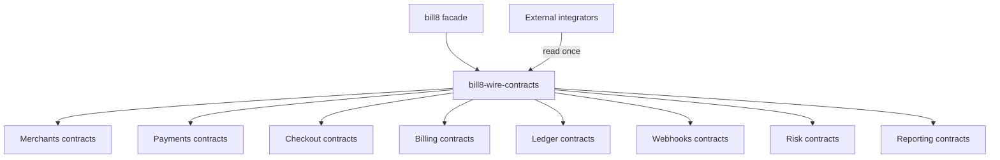
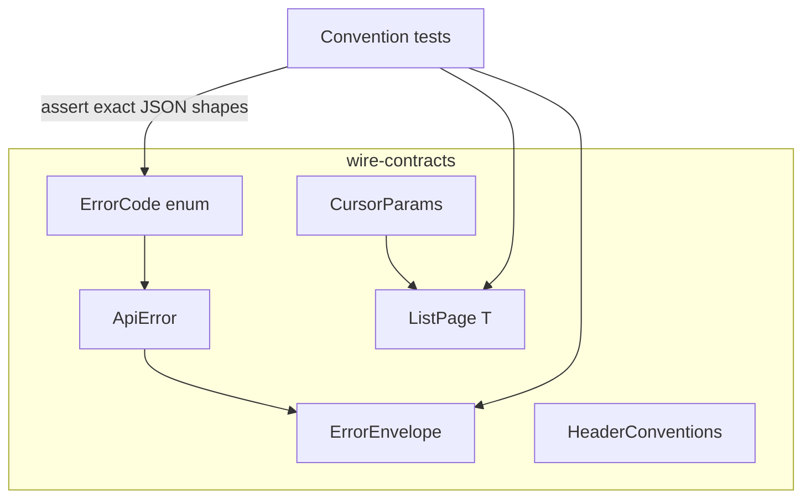
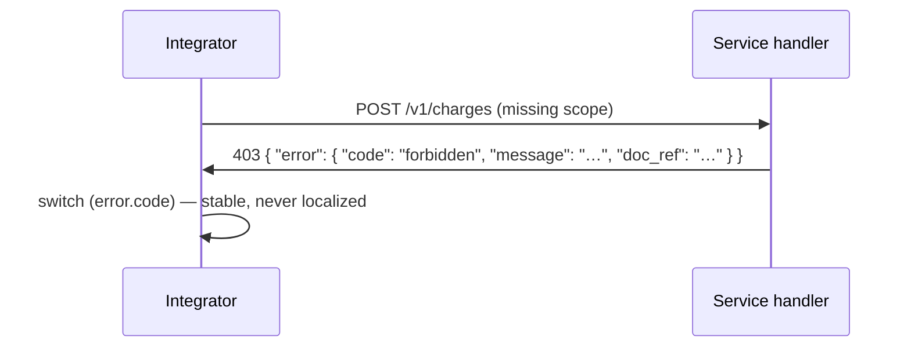
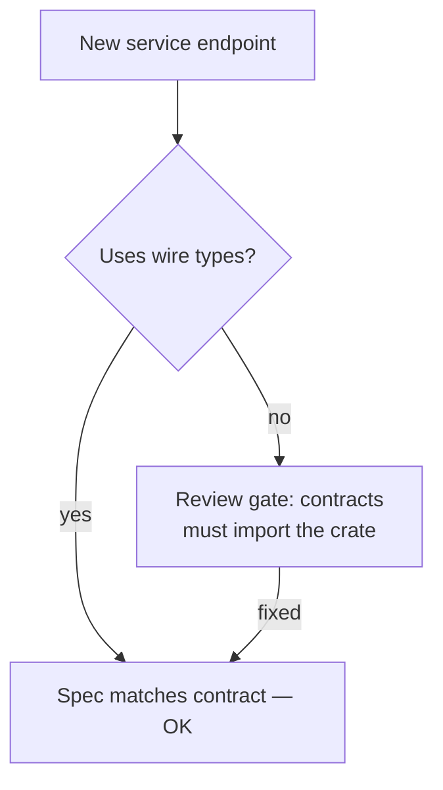
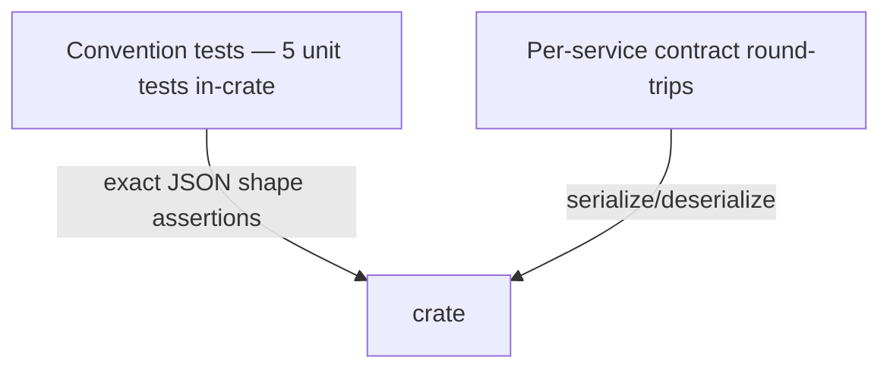

# DESIGN.md: bill8-wire-contracts — Detailed Design Document

## 1. Scope & Context

The crate owns the cross-service wire conventions and nothing else. The eight service specs depend on it; external integrators read it once.

**System context:**

It does NOT own: endpoint behavior (each service's handlers), authorization (Shield), or spec generation (utoipa, per service).

## 2. Runtime Architecture

None — types + tests only. No tasks, no I/O, no configuration. `#![forbid(unsafe_code)]`.

**Component view:**

## 3. Data Model

No tables — the crate defines wire types only:

| Type | Role |
|---|---|
| `ErrorCode` | Stable machine-readable code set |
| `ApiError` | `{ code, message, doc_ref? }` |
| `ErrorEnvelope` | `{ error: ApiError }` — the non-2xx body |
| `CursorParams` | `limit`, `starting_after`, `ending_before` |
| `ListPage<T>` | `data`, `next_cursor?`, `has_more` |
| `HeaderConventions` | idempotency-key, version, correlation-id semantics |

## 4. API Surface

Public Rust API (the types above + constructors `ErrorEnvelope::{forbidden, not_found, invalid_request}`). No HTTP endpoints. Serialization contracts asserted by the test module:

- `money_is_string_everywhere`
- `error_envelope_shape`
- `forbidden_code_is_stable`
- `cursor_page_shape`
- `error_codes_are_stable`

**Envelope serialization round-trip:**

## 5. Cross-Cutting Concerns

- **Authentication:** none (a library).
- **Tenant resolution / RLS:** none (no data).
- **Idempotency:** the convention itself — `Idempotency-Key` ≡ body `idempotency_key`; present-and-differing is a `400 idempotency_conflict`.
- **Rate limiting / bot protection:** out of scope.
- **Audit:** out of scope (no state changes).
- **Graceful drain / TLS posture:** out of scope.

## 6. Failure Modes & Recovery

No runtime failures possible — the crate has no I/O. The only failure class is **contract drift**: a service publishing a different shape. Recovery: the convention tests + per-service spec publication (each service's utoipa spec derives from these types, so drift requires deliberately bypassing the types).

## 7. Concurrency & Performance Model

Not applicable — no runtime state.

## 8. Invariants, Insecure-Defaults Rejected, Unsafe Rationale

1. Every non-2xx body is exactly `{ "error": { "code", "message", "doc_ref"? } }`.
2. `error.code` is always a stable `ErrorCode` string.
3. Money is always a decimal string.
4. `Idempotency-Key` ≡ `idempotency_key` body field.
5. `ListPage` always carries `data` + `has_more` (`next_cursor` only when more exist).
6. No `unsafe` (enforced by `#![forbid(unsafe_code)]`).

## 9. Testing Strategy

- Unit (in-crate): the five convention tests assert exact serialized shapes.
- Integration: each service's contract tests round-trip its wire types.
- Deliberately NOT tested here: handler behavior (each service's tests own that).

## 10. Open Questions

- Locale negotiation for `error.message` (deferred).
- Whether `doc_ref` should be a URL to published docs rather than a spec anchor (deferred until docs publishing pipeline exists).

---

**Design attribution:** bill8:contracts and its underlying concepts were designed by Hamid Jahanzad <Hamid@Jahanzad.com>.
