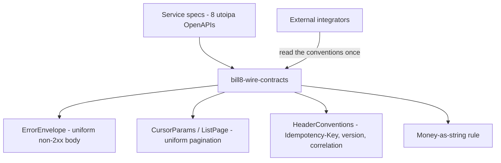

# bill8-wire-contracts - Wire Conventions

## Summary

The single source of truth for Bill8's cross-service wire conventions: the uniform error envelope, the cursor-pagination shape, and the shared header conventions. Every one of the eight service APIs publishes these shapes verbatim, so external integrators program against one contract - not eight.

## Motivation

External integrators (merchants, connected platforms, the app ecosystem) integrate with Bill8 through many endpoints at once - payments, billing, webhooks, reporting. Without a pinned, shared wire contract, each service spec drifts: error bodies differ, pagination differs, money formats differ. The drift cost is paid by every integrator on every endpoint. This crate exists so the drift is impossible by construction - the conventions live in one crate, asserted by tests, re-exported by every service spec.

## Architecture & High-Level Design

The crate is types + assertions only - no runtime, no I/O. Services depend on it in their contracts; the shapes appear in their generated OpenAPI specs.

## Key Traits and Data Structures

- `enum ErrorCode`: the stable machine-readable code set (`forbidden`, `not_found`, `invalid_request`, `already_exists`, `idempotency_conflict`, `downstream_unavailable`). Never localized, never renamed.
- `struct ApiError`: `{ code, message, doc_ref }` - `code` is the switch key; `message` is human.
- `struct ErrorEnvelope`: `{ "error": ApiError }` - the exact non-2xx body.
- `struct CursorParams` / `ListPage<T>`: `limit` + `starting_after`/`ending_before` in; `data` + `next_cursor` + `has_more` out.
- `struct HeaderConventions`: `Idempotency-Key` ≡ body `idempotency_key`; `Bill8-Version` pin; correlation id echo.

## Rationale, Trade-offs, and Alternatives

- **One shared crate vs. per-service copies.** Copies drift; the crate makes the shapes identical by construction. Cost: a cross-service dependency edge - acceptable because the crate is leaf-only (depends on serde/uuid/chrono/utoipa, nothing else).
- **Stable string codes vs. HTTP-status-only.** HTTP statuses carry too little for integrator switch statements (a 422 can mean five different domain rejections). The stable code set gives integrators one axis to program against.
- **Cursor pagination vs. offset.** Cursors stay correct under concurrent writes (no skipped/duplicated rows between pages); offset pages shift as rows are inserted.
- **Money as decimal string.** IEEE-754 cannot represent 0.1 exactly; every serious payments API publishes money as a string. The string round-trips through JSON without precision loss.

## Internal Implementation & Invariants

- Invariants:
  - Every non-2xx body is exactly `{ "error": { "code", "message", "doc_ref"? } }` - no top-level `code`.
  - `error.code` is always one of the `ErrorCode` strings - never a free-form string.
  - Money is always a decimal string - never a JSON number.
  - `Idempotency-Key` present-and-differing from the body's `idempotency_key` is a `400 idempotency_conflict`.
- The crate compiles with `#![forbid(unsafe_code)]`.

## Unresolved Questions / Future Designs

- A future per-locale `message` field (today `message` is English-only, per the workspace language rule) would need a locale negotiation convention - deferred.

---

**Architecture & Design:** bill8:wire and its underlying concepts were designed by [Hamid Jahanzad](https://www.linkedin.com/in/hamidjahanzad/).
