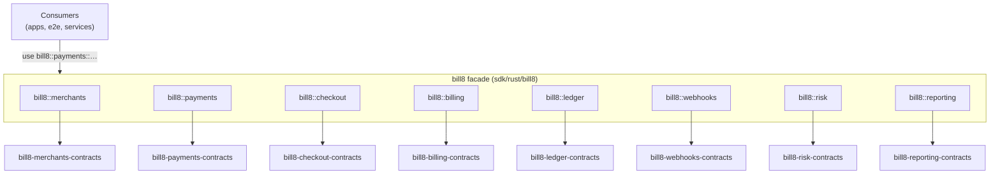

# bill8 - Rust namespace facade

The unified Rust entry point for the bill8 vertical: SDK clients and
contracts for all eight services, imported as
`bill8::{service}::{…}`.

## 1. Summary

`bill8` is the workspace's namespace facade (architecture-principles
§2.1): every bill8 crate is reachable through this one crate, and
consumers never import a leaf crate directly. Each service module nests
its SDK client plus its contracts crate, giving applications one typed
client per backend service with correlation-ID propagation built in.

## 2. Motivation

Vertical consumers (apps, e2e tooling, internal services) need one
import surface that (a) hides the crate graph behind a stable namespace,
(b) enforces the same client conventions (builder pattern, bearer token,
correlation header) across all services, and (c) keeps zero vertical
knowledge inside the platform SDK.

## 3. Architecture & High-Level Design

The facade's shared plumbing (`ClientBuilder`, `CORRELATION_ID_HEADER`,
`prepare_request`) gives every client the same wire discipline: a fresh
UUID v4 correlation id per request and bearer auth when a token is
attached.

## 4. Key Traits and Data Structures

- `trait ClientBuilder` - the uniform builder contract every service
  client implements (`with_base_url`, `with_token`, `with_http_client`).
- One typed client per service (`MerchantsClient`, `PaymentsClient`,
  `CheckoutClient`, `BillingClient`, `LedgerClient`, `WebhooksClient`,
  `RiskClient`, `ReportingClient`), each mapping 1:1 to its service's
  endpoints and decoding into contracts types.
- `CORRELATION_ID_HEADER` / `generate_correlation_id()` - the
  cross-service tracing convention.

## 5. Rationale, Trade-offs, and Alternatives

- **One facade over direct leaf imports**: a single namespace enforces
  conventions and hides the crate graph; leaf imports are a defect in
  consumers.
- **Correlation-ID built in**: every client injects a correlation id,
  so cross-service traces line up without caller effort.

## 6. Internal Implementation & Invariants

- `#![forbid(unsafe_code)]`.
- Every client reuses a single `reqwest::Client`; clients are cheap to
  clone.

## 7. Unresolved Questions / Future Designs

- None - the facade shape mirrors the service set at design time.

---

**Design attribution:** bill8 (facade) and its underlying concepts were designed by Hamid Jahanzad <Hamid@Jahanzad.com>.
